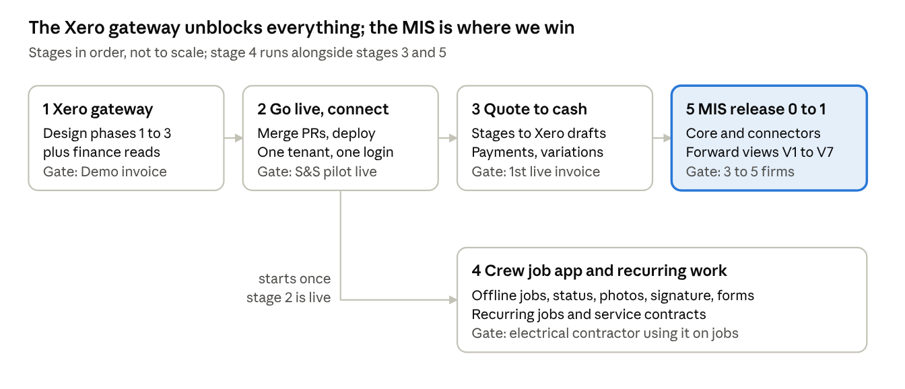

# Product suite roadmap: quoting, scheduling, timesheets and MIS

Version 0.1, 4 November 2026. Owner: John Olivant. Editable copy: [Claude doc](https://claude.ai/artifact/SpZ98LTBWydR4xEZ1aYCmJ).

## Summary

Build the Xero gateway first, get the three apps live and connected, then close quote-to-cash and start the MIS. Every financial feature and every MIS view is blocked on the gateway, which today is a design only.

- **Where we are:** quoting is at phase 7 of 10; the scheduler and timesheet have production Postgres builds on branches, not yet live; the MIS is a product description with no code.
- **Against Simpro and Workever:** we already beat Workever on estimating depth and compliance-aware scheduling. Our real gaps are Xero sync, invoicing, a crew job app and recurring work.
- **Positioning:** lead with the MIS, sold through Rule29 as a forward view of cash, capacity and margin. The operational apps feed it. No light competitor both runs jobs and forecasts.

## Where each system stands

None of the five systems is live in production yet; quoting is furthest along. Status is taken from each repo's README, design and production branches on 4 November 2026.

| System | Repo / branch | Built | Not built | Live? |
| --- | --- | --- | --- | --- |
| Quoting | [sands-quoting](https://github.com/JohnOlivant/sands-quoting) `main` | Estimating engine (alternatives, options, margin floor, overrides, regression tests); approvals; proposal PDF; payment stages; customer link with tick-and-sign acceptance, view tracking, reminders, expiry; kits; supplier price import; pipeline report; offline field mode with photos; handover to the scheduler | Xero and invoicing (phase 6), variations, job costing (phase 8), most reports (phase 9) | No, phase 7 of 10 |
| Job Scheduler | [job-scheduler](https://github.com/JohnOlivant/job-scheduler) `production/foundation` | Rule engine (skills, certificate expiry, crew minimums, double-booking, written overrides); RAMS; Gantt timeline; planned vs used hours; personal job tickets by AWS SES; quoting link; 21 cross-company attack tests; standalone and connected modes | Recurring jobs (open design question), worker-facing app, maps and travel ranking, WhatsApp | No, pilot-readiness items open; Sheets pilot in use |
| Timesheet | [timesheet-pilot](https://github.com/JohnOlivant/timesheet-pilot) `production/postgres-foundation` | Weekly entry; supervisor and payroll approvals; expenses with receipts, mileage, subsistence; leave; client sign-off on site; reports; Xero payroll CSV batch for Upsheets | Xero API push, MFA, notifications, RLS review; scheduler interface is draft PR #5 | No, README says not yet production-ready payroll; Sheets pilot in use |
| Xero gateway | [xero-gateway](https://github.com/JohnOlivant/xero-gateway) `main` | Design document: contacts, quotes, invoices, Projects, Payroll UK timesheets, webhooks, 6 phases | All code; finance reads (payments, bills by tracking category, P&L, bank) are not in the design | No, design only |
| MIS | [Management-Information-System](https://github.com/JohnOlivant/Management-Information-System) `main` | Product description v0.1, systems briefing, market check | All code: forward finance core, connectors, advisor workspace | No, not started |

## Competitor comparison

We lead Workever on estimating and compliance scheduling, and neither competitor forecasts; we trail both on Xero sync, invoicing and a crew job app.

[Simpro](https://www.simprogroup.com/) is the heavyweight: quote-based pricing, typically reported at £100 to £150 per user per month in the UK plus a £2,000 to £10,000 setup fee, multi-year contracts and a steep learning curve ([Kaeltripton](https://www.kaeltripton.com/simpro-uk/), [Capterra](https://www.capterra.com.au/software/10529/simpro-enterprise)). [Workever](https://workever.com/) is UK mid-market at £29 (Base) or £39 (Ultimate) per user per month, no contract, and already sells to electrical contractors ([pricing](https://workever.com/pricing/)).

| Capability | Simpro | Workever | Our suite | Priority |
| --- | --- | --- | --- | --- |
| Estimating with margin control, alternatives, approvals | Yes, with prebuilds and takeoffs | Basic quotes, saved cost items | Built | Ahead |
| Online quote acceptance to job | Yes | Convert quote to job | Built | Level |
| Skills, certificate expiry and RAMS in scheduling | Partial | No | Built | Ahead |
| Forward view of cash, capacity, WIP, margin | BI add-on, backward-looking | Profit and loss on Ultimate | MIS designed | Our differentiator |
| Xero sync (contacts, invoices, payments) | Yes | Yes, all tiers | Design only | Essential |
| Invoicing from the job or payment stages | Yes, incl. progress billing | Yes | Designed (quoting phase 6) | Essential |
| Crew job app: status, photos, notes, signature, offline | Yes | Yes, all tiers | Tickets by email only | Essential |
| Recurring work and service contracts | Yes | Ultimate | Open question | High |
| Digital forms and certificates | Add-on | Ultimate | No | High for electrical |
| Job costing, quoted vs actual | Yes | No | Designed (quoting 8.6) | High |
| Customer portal for job updates | Yes | Ultimate | Proposal link only | Medium |
| Asset register | Yes | Ultimate | No | Medium |
| Stock and purchase orders | Deep | Ultimate | No | Later |
| GPS, map view, route optimisation | Yes | GPS and map | No | Skip |

## Positioning

Sell the MIS through Rule29 as the product; sell the operational apps as the best way to feed it. Competing app-for-app with Workever at £29 to £39 per user puts us on their ground.

- **The pitch:** simpler than Simpro, smarter than Workever. The only light suite that shows, while jobs are live, whether the firm will have the cash and the people for the next three months and which jobs are losing money.
- **Who buys:** owners of 5 to 50 person UK construction and building services firms who use Xero and an accountant (MIS product description, section 3).
- **Reach beyond our apps:** the MIS must also read Tradify, Simpro and spreadsheets (release 3), so a Simpro user is a prospect, not a lost sale.
- **Price hypothesis, not validated:** £50 to £150 per firm per month for the MIS, with the operational apps per user on top. Test with 8 to 10 Rule29 clients before MIS release 1 ends.

## Roadmap

Five stages in order, each closed by a gate; the crew app runs in parallel once the apps are live. No dates are set yet: each stage is sized once the one before it is under way.

Everything above the line depends on the stage to its left; the crew app needs only live, connected apps.

| Stage | Scope | Depends on | Done when |
| --- | --- | --- | --- |
| 1. Xero gateway | Design phases 1 to 3: connection manager, contacts, quotes and invoices; move the timesheet export onto it; add finance reads (invoices, payments, bills by tracking category, bank balance) to the design and build them | Nothing | An invoice round-trips with the Xero Demo Company and payment status comes back |
| 2. Go live and connect | Merge timesheet PR #5 and scheduler PR #1; deploy both to Krystal; scheduler in connected mode; one tenant identity and shared sign-in; SES sending domain | Stage 1 started | S&S runs quoting, scheduling and timesheets live, one job number end to end |
| 3. Quote to cash | Quoting phase 6: payment stages raise draft Xero invoices, payment status back, variations and recharges, CIS and retention on invoices | Stages 1 and 2 | The first live job is invoiced from its accepted quote with no retyping |
| 4. Crew job app and recurring work | Phone app built from quoting's offline field mode: today's jobs, status, photos, notes, signature, digital forms and certificates, start and stop time into timesheets; recurring jobs and service contracts in the scheduler | Stage 2; recurring-work decision | The electrical contractor runs live jobs on it and periodic inspections schedule themselves |
| 5. MIS releases 0 and 1 | Forward finance core, connectors for the three apps and the gateway, views V1 to V7, alerts A1 to A3, advisor workspace W1 to W3; quote fields G1 and G6; cost rates (G2) and quoting job costing (phase 8) | Stages 2 and 3 | 3 to 5 Rule29 construction clients live with weekly owner use and a monthly advisor review |

## Not building

These are Simpro's territory and would add complexity without adding our edge; build them only when paying clients ask.

- Stock control and purchase orders
- GPS tracking, map view and route optimisation
- Drag-and-drop dispatch boards
- Drawing take-off and BI dashboards beyond the MIS views
- Card payments of our own: payments stay in Xero (quoting decision D13)

## Decisions needed

Three of these gate stage 2; settle each before the work it gates starts.

| Decision | Gates | Owner | Source |
| --- | --- | --- | --- |
| Merge timesheet PR #5 and scheduler PR #1; switch the scheduler to connected mode | Stage 2 | John | Scheduler pilot readiness |
| Email provider and sending domain (AWS SES, DKIM) | Stage 2 | John | Scheduler decision C5 |
| One tenant identity across apps (`client_id` vs `company_id`) and shared sign-in | Stage 2 | John | MIS gap G5, scheduler C3 |
| Recurring jobs and service contracts: how they work, before the schema settles | Stage 4 | John, with the electrical contractor | Scheduler open question A3.8 |
| CIS treatment checked with the accountant | Stage 3 | Rule29 | Quoting decision D14 |
| Cost rates per worker or per role, and who may see them | Stage 5 | Pilot firms, Rule29 | MIS Q3, gap G2 |
| WIP method Rule29 will sign off: hours, cost-to-cost or valuation | Stage 5 | Rule29 | MIS Q1 |
| Who pays for the MIS (firm or accountant) and at what price | End of MIS release 1 | 8 to 10 Rule29 clients | MIS Q2 |
| AI provider for commentary | MIS release 1 | John | MIS Q7 |

## Sources

- Repositories: [sands-quoting](https://github.com/JohnOlivant/sands-quoting), [job-scheduler](https://github.com/JohnOlivant/job-scheduler), [timesheet-pilot](https://github.com/JohnOlivant/timesheet-pilot), [xero-gateway](https://github.com/JohnOlivant/xero-gateway), [Management-Information-System](https://github.com/JohnOlivant/Management-Information-System)
- [Workever home page](https://workever.com/) and [Workever pricing](https://workever.com/pricing/)
- [Simpro Review UK 2026, Kaeltripton](https://www.kaeltripton.com/simpro-uk/)
- [Simpro reviews, Capterra Australia](https://www.capterra.com.au/software/10529/simpro-enterprise)
- [Simpro pricing, Capterra](https://capterra.com/p/10529/Simpro-Enterprise/pricing/)
- [simPRO API overview, Supergood](https://supergood.ai/docs/simpro-api)
