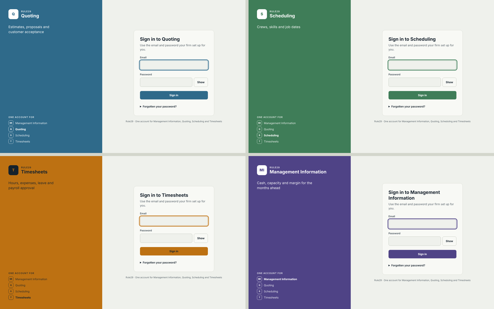

# Shared sign-in for the four apps

Version 0.1, 8 November 2026. Owner: John Olivant. Code: [signin/](../signin/README.md).

## Summary

One sign-in service, in this repository under `signin/`, gives Quoting, Scheduling, Timesheets and the MIS one login page and one session. Each app keeps its own database, roles and firm data; it only stops checking passwords itself and asks the sign-in service who the visitor is. This is the "shared sign-in" item in roadmap stage 2 and helps close MIS gap G5.

| | Login page | Session check |
| --- | --- | --- |
| Before | Three separate forms and account tables (quoting, timesheet, scheduler standalone) | Each app reads its own `sessions` table |
| After | One page at e.g. `signin.example.co.uk`, showing the app's name and colour | Each app posts the cookie to `/api/service/verify` with its key |

## What the apps do today

All three built apps already use the same security model (scrypt, hashed session tokens, CSRF token, 8-hour sessions, login limits), copied from the timesheet. Quoting decision 19 October: "shared sign-in is a nice-to-have... built on the timesheet's security model so it can move to the shared sign-in later."

| App | Sign-in now | Firm key | Notes |
| --- | --- | --- | --- |
| Quoting (`sands-quoting`) | Own `quoting.accounts`, cookie `sq_session`, React `SignIn.tsx` | `company_id` | Separate database; talks to the scheduler over HTTP |
| Timesheets (`timesheet-pilot`, production branch) | Own `timesheet.accounts`, cookie `r29_session` | `client_id` | Same database as the scheduler |
| Scheduling (`job-scheduler`, production branch) | Connected mode reads the timesheet's session through `integration.verify_session_v1`; standalone mode has its own accounts | `client_id` | Already a shared sign-in with the timesheet |
| MIS | Not built | Not decided | Uses the shared sign-in from day one |

## Decisions taken (Claude's defaults, change if wrong)

| Decision | Choice | Why |
| --- | --- | --- |
| Where it lives | `signin/` in this repository | The MIS has no code yet and is the product the others feed; a separate repository can be split out later without changes |
| Build or buy | Build, on the apps' existing model | No new supplier or monthly cost; existing scrypt hashes copy straight across; Auth0, Clerk or Cognito stay possible later because apps only call `verify` |
| How apps check sessions | HTTP with a per-app key, not a shared database | Quoting has its own database and the suite already uses HTTP and JSON between apps |
| Cookie | One `r29_signin` cookie on the parent domain, `SameSite=Lax` | Apps must sit on subdomains of one domain (e.g. `quoting.`, `schedule.`, `time.`, `mis.`) |
| Firm id | Each access row stores the id the app already uses | Doesn't force the `client_id` vs `company_id` choice; the sign-in passes it on unchanged |
| Password reset | Administrator resets, temporary password changed at first sign-in | Matches live quoting; self-service email reset waits for the email provider decision (SES) |
| Roles | Stay in each app; the sign-in passes the role string on | Roles differ by app (estimator, payroll, scheduler) |

## Moving each app across

Each app changes in the same three places: its login form goes, `authenticate` calls the client instead of its own `sessions` table, and its sign-out and change-password links point at the sign-in page.

1. **Timesheets first.** Copy `timesheet.accounts` (email, password hash) into `identity.accounts` with `must_change_password` kept, and each membership into `identity.app_access` (`app = timesheets`, `tenant_id = client_id`, `role`). Replace `authenticate()` in `production/app.js` with the client; drop `/api/login` and the login form.
2. **Scheduling.** Connected mode already trusts the timesheet's session; point `verify_session_v1` callers at the client instead (`app = scheduling`). Standalone mode can stay for firms without the timesheet.
3. **Quoting.** Same copy from `quoting.accounts` and `memberships` (`tenant_id = company_id`). Replace `authenticate()` in `server/src/app.ts` and `SignIn.tsx` with a redirect to `signInUrl(location.href)`. The customer proposal link has no sign-in and is unchanged.
4. **MIS.** Uses the client from its first commit.

Until an app moves, it keeps working on its own sign-in; nothing here changes the apps.

## Still to decide

| Question | Gates | Default if no answer |
| --- | --- | --- |
| The domain the four apps live under (cookie domain) | Deploying the sign-in | One domain with a subdomain per app |
| One firm id across apps (`client_id` vs `company_id`, gap G5) | MIS release 0 | Keep both; the access table maps each |
| Two-step sign-in (MFA), required for payroll and advisor users? | Timesheet go-live (its README lists MFA as not built) | Add TOTP to the sign-in service, once, for every app |
| An admin screen for accounts and access | First firm with more than a handful of users | `scripts/add-account.js` until then |
