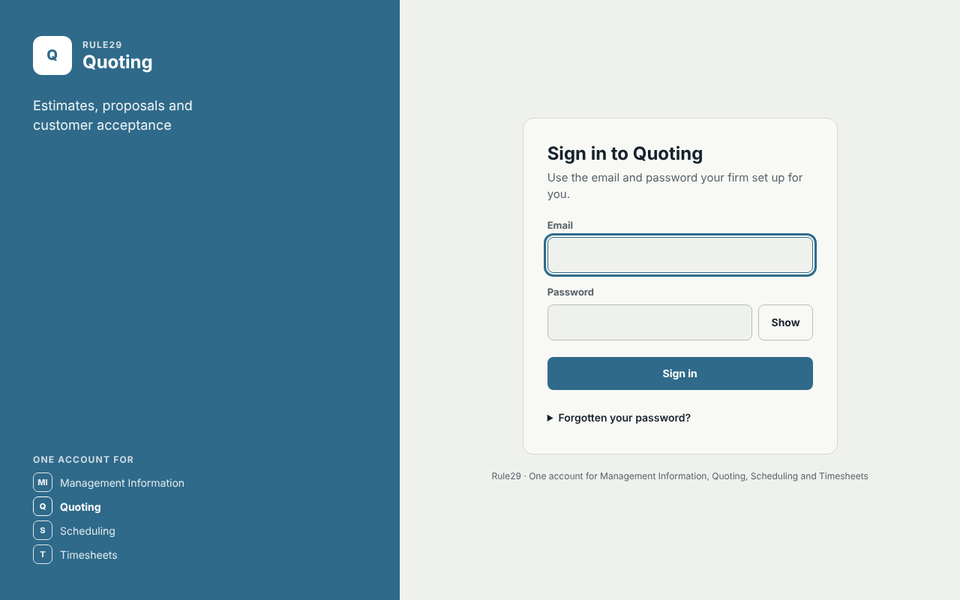

# Shared sign-in

One sign-in page and one session for the four apps: Quoting, Scheduling, Timesheets and Management Information. Each app sends people here, the page shows that app's name and colour, and after sign-in they go straight back. Signing in to one app signs them in to all the apps their account opens; signing out signs them out of all of them.

Why and how it fits the apps: [docs/shared-sign-in.md](../docs/shared-sign-in.md).



## Run it locally

```sh
cd signin
npm install
npm run demo        # http://localhost:3900, in-memory demo accounts, password demo-password-1
```

Try `http://localhost:3900/?app=quoting`, `?app=scheduling`, `?app=timesheets` or `?app=mis`. Without `?app` the page signs people in and then lists the apps they can open.

| Demo account | Opens |
| --- | --- |
| `owner@example.com` | Every app, and the setup page at http://localhost:3900/setup |
| `crew@example.com` | Timesheets only |
| `new@example.com` | Quoting, and must change the temporary password first |

## Tests

```sh
npm test                                                             # behaviour tests, in memory
TEST_DATABASE_URL=postgresql://postgres@localhost/signin_test npm run test:integration   # the same tests on PostgreSQL
```

The PostgreSQL run applies every file in `db/` to a fresh schema for each test and runs the service as the narrow `rule29_signin_app` role, so the grants are tested too.

## Pages

| Address | Screen |
| --- | --- |
| `/?app=<id>&return=<address>` | Sign in to that app, then back to `return` (only if it is one of that app's own addresses) or the app's home page |
| `/` | Sign in, then choose an app |
| `/password` | Change password (every app) |
| `/signout?app=<id>` | Sign out of every app |
| `/setup` | People and apps: for setup administrators only (see below) |

A temporary password must be changed before any app opens. Forgotten passwords are reset by the firm's administrator, as on the live quoting system; there is no self-service reset email until an email provider is chosen.

## Settings

| Variable | Meaning |
| --- | --- |
| `SIGNIN_ORIGIN` | This service's own address, e.g. `https://signin.example.co.uk`. Browser posts from any other address are refused. Must be https in production |
| `COOKIE_DOMAIN` | The parent domain all four apps share, e.g. `example.co.uk`, so the session cookie reaches every app |
| `DATABASE_URL` | PostgreSQL, as `rule29_signin_app`. Without it the service runs the in-memory demo (refused when `NODE_ENV=production`) |
| `SIGNIN_KEY_QUOTING`, `SIGNIN_KEY_SCHEDULING`, `SIGNIN_KEY_TIMESHEETS`, `SIGNIN_KEY_MIS` | Each app's service key, 32+ random characters, used by that app to check sessions |
| `APPS_FILE` | The apps file; defaults to `apps.json`. Production lists each app's real `homeUrl` (and any other `origins` it serves from) |
| `TRUSTED_PROXY` | `loopback` behind a reverse proxy on the same machine, otherwise `none` |
| `PORT`, `HOST` | Default `3900`, `127.0.0.1` |

`apps.json` holds each app's name, tagline, mark (up to three letters), colour and home address. A new app is one more entry and one more key.

## People and apps (the setup page)

`/setup` is where an administrator chooses who can open each app, at which firm, and with what role. It lists every login with its apps; **Change** opens one person, where you can rename them, switch their login off, let them use the setup page, give or take away each app at each firm with its role, and reset their password. **Add a person** makes a login with a temporary password they change at first sign-in. The launcher shows a **People and apps** link to anyone allowed to use it.

The sign-in is where roles live. Each app reads the role from the session it checks (`session.access[].role`) and follows it: Scheduling always has; Timesheets and Quoting copy it into their own records when the person opens them. Each app's roles are listed in `src/apps.js` (an apps file entry can give its own `roles` and `multipleRoles`):

| App | Roles | Several at once |
| --- | --- | --- |
| Management Information | `admin`, `viewer` | No |
| Quoting | `estimator`, `approver`, `rate_admin`, `accounts`, `operations`, `admin` | Yes, stored as a comma-separated list |
| Scheduling | `scheduler`, `admin` | No |
| Timesheets | `worker`, `supervisor`, `payroll`, `admin` | No |

Firms are listed per app from the access that already exists; a new one is added by typing the id that app uses for it (`company_id` in Quoting, `client_id` in Timesheets and Scheduling). Taking access away, or switching a login off, signs the person out everywhere; a role change reaches the apps within 30 seconds.

Only accounts with `setup_admin` can open it, and nobody can switch off their own login or setup access. The first setup administrator is set on the server (see [deploy/RUNBOOK.md](deploy/RUNBOOK.md)).

## Accounts

```sh
DATABASE_URL=... node scripts/add-account.js jo@firm.co.uk "Jo Bloggs" quoting:<company_id>:estimator timesheets:<client_id>:worker
```

prints a temporary password. Each grant is `app:tenantId[:role[:firm name]]`, where `tenantId` is the id that app already uses for the firm (`company_id` in quoting, `client_id` in the timesheet and scheduler). The setup page does the same without a command line.

## Using it from an app

`client/index.js` has no dependencies.

```js
const {createSignInClient} = require('rule29-signin');           // or copy client/index.js
const signin = createSignInClient({signinUrl: process.env.SIGNIN_URL, appId: 'quoting', serviceKey: process.env.SIGNIN_KEY});

const session = await signin.authenticate(req);
if (!session) return redirect(signin.signInUrl(currentAddress));  // API calls answer 401 and the page redirects
// session: {accountId, email, displayName, csrfToken, expiresAt, access: [{tenantId, tenantName, role}]}
// Check X-CSRF-Token on writes against session.csrfToken. Pick the firm from session.access.
```

`signin.signOutUrl()` and `signin.passwordUrl()` give the links for the app's menu. Answers are cached for 30 seconds, so a sign-out elsewhere reaches an app within 30 seconds.

Server to server, an app posts `{token}` (the `r29_signin` cookie value) to `/api/service/verify` or `/api/service/end-session` with `Authorization: Bearer <its key>`. Verify returns `{session: null}` or the session with only that app's access.

An app's own user screen keeps working through two more calls, both limited to that app:

- `signin.provision({email, displayName, tenantId, tenantName, role, active, temporaryPassword})` gives access at one firm (creating the login, with the temporary password, if it is new) or with `active: false` removes it and signs the person out. An existing login keeps its password.
- `signin.resetPassword({email, tenantId, temporaryPassword})` works only for someone with access to that app at that firm, and signs them out everywhere.

## Moving an app's existing logins across

```sh
DATABASE_URL=<sign-in db, owner role> node scripts/import-accounts.js timesheets <timesheet db url>
DATABASE_URL=<sign-in db, owner role> node scripts/import-accounts.js quoting <quoting db url>
```

All the apps hash passwords the same way, so people keep their passwords. Someone already in the sign-in from another app keeps that password and gains access. Safe to run twice.

## Putting it live

`deploy/` installs it on the server next to the other apps: `ship.sh` from your computer, then `import-logins.sh` and `connect-app.sh` on the server. The steps are in [deploy/RUNBOOK.md](deploy/RUNBOOK.md).

## Security

Same model as the three apps today: scrypt password hashes (and the same `scrypt:salt:hash` format, so existing hashes can be copied across), hashed 256-bit session tokens, 8-hour sessions, a CSRF token per session, 5 failed attempts per account and 30 per address in 15 minutes, one error message for unknown email and wrong password. Changing a password ends the account's other sessions. The cookie is `HttpOnly`, `Secure` on https, and `SameSite=Lax` so a link from an email into an app keeps the person signed in. Return addresses must belong to the app that asked, so the page can't be used to bounce people to another site. The page sends a strict Content Security Policy and can't be framed.
